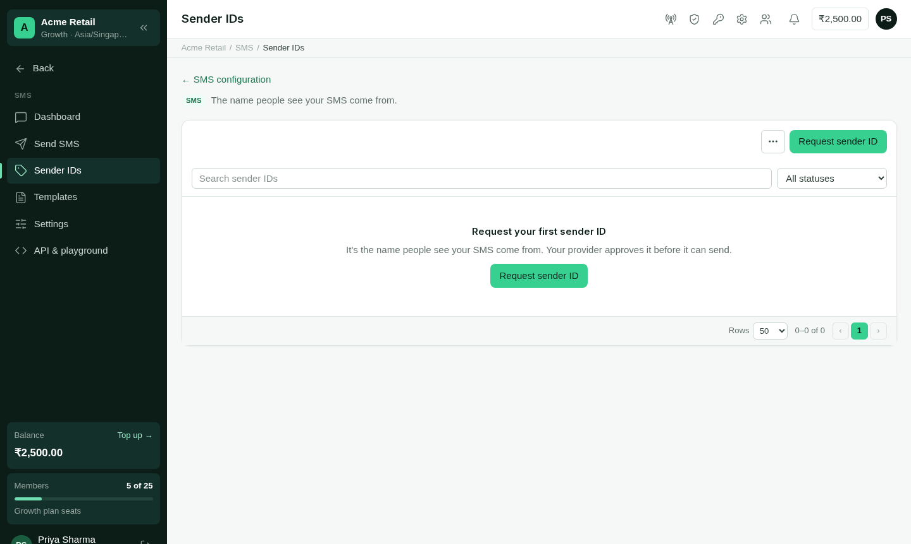
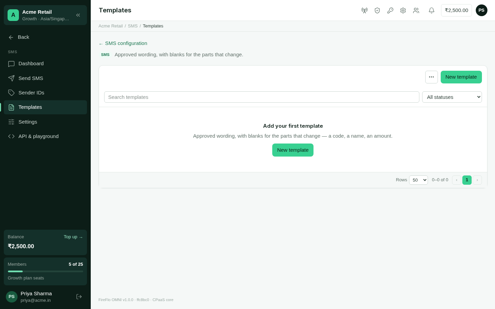

Before an SMS goes out, your provider may check two things: that it comes from an
**approved sender ID**, and that its wording matches an **approved template**. You
request both in OMNI; your provider reviews them.

Both screens say at the top how strictly your account is checked:

| What the screen says | What it means |
| :--- | :--- |
| Only approved sender IDs can send on your account. / Messages must match an approved template on your account. | Anything unapproved is refused. |
| Your provider is noting messages without approved sender IDs (or templates), but not refusing them yet. | Unapproved messages go out, and are noted. |
| Any sender ID is accepted on your account — approval is optional. / Any wording is accepted on your account — templates are optional. | Nothing is checked. |

## Sender IDs

A **sender ID** is the name people see your SMS come from.

<Steps>
  <Step title="Start a request">
    Open **SMS → Sender IDs** and choose **Request sender ID**.
  </Step>
  <Step title="Enter the sender ID">
    Exactly as recipients will see it — casing counts. Use up to 11 letters or digits,
    or a phone number.
  </Step>
  <Step title="Add a label and a reason (optional)">
    The **label** is for you and is never matched against anything. **Why you need it**
    is read by whoever reviews it; a good reason is answered faster.
  </Step>
  <Step title="Send request">
    It shows as **Waiting for approval** and can send once it is approved.
  </Step>
</Steps>

<Frame caption="Sender IDs, with each one's status.">
  
</Frame>

### What a sender ID can be

- Letters, digits and ordinary punctuation, with no spaces at the start or end — it is
  matched exactly.
- At most 64 characters. Longer than 21 won't reach most carriers, and names longer than
  11 characters are cut or refused by some carriers. The form warns you as you type.

### Its status

| Status | Meaning |
| :--- | :--- |
| **In use** | Approved. It can send. |
| **Waiting for approval** | With your provider. You can **Withdraw** the request. |
| **Not approved** | Turned down, with the reason underneath. |
| **Withdrawn** | You withdrew the request. You can request it again later. |

<Warning>
  Changing an **In use** sender ID, or its reason, sends it back for approval — and
  messages from it are refused until your provider approves it again. OMNI asks you to
  confirm first.
</Warning>

## Templates

A **template** is approved wording with **blanks** for the parts that change: a code, a
name, an amount.

<Steps>
  <Step title="Start a template">
    Open **SMS → Templates** and choose **New template**.
  </Step>
  <Step title="Name it">
    What you and your provider call it.
  </Step>
  <Step title="Write the wording">
    Use **Insert a blank** to add the parts that change. Under the box, OMNI shows an
    example message the template would accept, with its number of segments.
  </Step>
  <Step title="Submit for approval">
    Add a **note for the reviewer** if it helps — a registration reference, for example.
  </Step>
</Steps>

<Frame caption="SMS templates, with their blanks drawn as chips.">
  
</Frame>

### Blanks

| Blank | Accepts |
| :--- | :--- |
| `{#var#}` | anything |
| `{#num#}` | digits only |
| `{#alp#}` | letters, spaces, apostrophes and hyphens |

```text
Hi {#alp#}, order {#var#} is out for delivery.
```

### How a message is matched

**Everything around a blank is matched exactly** — every word, space and punctuation
mark. Only the blanks change. Wording with no blank approves exactly one message.

When you send with **Use a template**, OMNI shows a box for each blank and won't send
until every blank holds something its kind accepts.

OMNI refuses wording that could never match safely:

- more than 2,000 characters;
- a blank in the wrong case or spelling, such as `{#VAR#}` or `{#code#}`;
- `{{1}}` — that is WhatsApp's blank, not SMS's;
- a template that is nothing but a blank, which would accept every message;
- two blanks with nothing between them, which can't be told apart.

<Warning>
  Changing the name or wording of an **In use** template sends it back for approval, and
  messages using it are refused until it is approved again. To keep sending meanwhile,
  submit the new wording as a separate template.
</Warning>

## Many at once

The **⋯** menu on both screens imports and exports the list as a CSV or Excel file. An
export has exactly the columns an import reads, so a downloaded list is a working file.
After an import, OMNI says how many rows were submitted and how many refused, and lets
you download the refused rows with their reasons.

## DLT (India)

India's DLT registry gives every business an **entity ID**, and every registered
template a **template ID**. Messages to India carry them.

<Steps>
  <Step title="Switch DLT on">
    In **SMS → Settings → Stamps and DLT**, turn on **We send to India under DLT**.
  </Step>
  <Step title="Enter your DLT entity ID">
    Issued once per business by the DLT registry. It goes with every send.
  </Step>
  <Step title="Add the DLT template ID to each template">
    The template and sender ID forms now show **DLT template ID** and **DLT entity ID**
    fields. Enter the DLT template ID from your DLT portal — it is numeric. A sender ID or
    template can carry its own entity ID; it defaults to the one in SMS settings.
  </Step>
</Steps>

With DLT off, these DLT fields don't appear. The identifiers travel as stamps (below):
**0x1400** for the entity ID and **0x1402** for the template ID, unless your provider uses
other tags, which you can change in the same settings.

## Stamps

A **stamp** is an extra value an SMS carries alongside its text: a tagged parameter, such
as a registration reference your provider or a carrier asks for. Stamps are entirely
optional. A sender ID, template or account with none sends its messages without any.

| Where you set it | It goes on |
| :--- | :--- |
| **SMS → Settings → Stamps and DLT → Add a stamp to every SMS** | every SMS from your account |
| A sender ID's **Stamps** | every SMS sent from that sender ID |
| A template's **Stamps** | every SMS sent with that template |

To add one, open the sender ID or template, choose **Add a stamp**, and enter a **tag**
and a **value**. **Remove stamp** takes one off; with none left, nothing is stamped. The
Sender IDs and Templates lists show each one's stamps in a **Stamps** column.

- **Sender ID and template stamps apply once they're approved.** A request still waiting
  for approval shows its stamps with **Applied once approved**. Changing stamps doesn't
  send an approved sender ID or template back for approval.
- **Every SMS, however it's sent, carries them.** That covers the Send page, scheduled
  sends, broadcasts, Inbox replies, AI agents, fallback from other channels, verification
  codes and the OMNI API.
- **The every-SMS stamp works with DLT on or off.**
- **The most specific value wins.** When two sources set the same tag, the template's
  value beats the sender ID's, which beats your account's. A stamp set on a single send
  through the OMNI API beats them all.
- **The Send page and the broadcast wizard show what a message will carry.** They list
  each stamp, saying whether it comes from your account, the sender ID or the template.

**Tags and values:**

- Write a tag in hex, like `0x1501` (at most `0xFFFF`). A bare number such as `5120` is
  refused, with the hex to use instead (`0x1400`).
- On a sender ID or a template, the tag is plain hex. The every-SMS stamp can also name a
  type, such as `name_0x1600:Int4`, and then its value must be a whole number that fits
  that type.
- A value is up to 255 characters.

<Note>
  Stamps travel to your provider as your own parameters. Your provider may set its own
  value for a sender ID or template, which takes the place of yours, and a carrier passes
  on only the tags it accepts.
</Note>

<Tip>
  Write tags as hex, like `0x1401`. A bare number is read as decimal, and the carrier
  would quietly ignore it — the form refuses it.
</Tip>

## From your own software

The OMNI API lists, requests and withdraws [sender IDs](/api-reference/sms/list-senders)
and [templates](/api-reference/sms/list-templates), with the same rules.

## Who may

Requesting, editing and withdrawing sender IDs and templates needs the permission to
**manage sender IDs and template registrations** — the **Owner** and **Admin** roles by
default; the same permission sets their stamps. Switching DLT on, setting the entity ID
and the every-SMS stamp is in SMS settings, which needs the permission to **configure
channel modules** (Owner and Admin by default).
