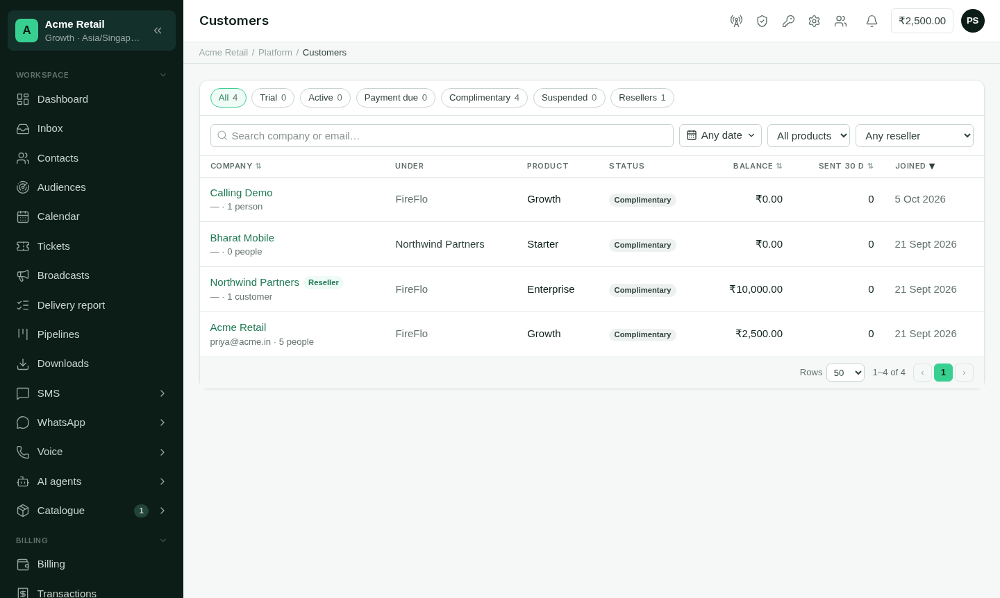

**Platform → Customers** lists every account on your service, including the customers of
your resellers. Open one to see everything about it and to make the changes only staff
can make.

<Frame caption="Platform → Customers: every account, its product, status and balance.">
  
</Frame>

## Set a customer up

Customers usually arrive through [self-signup](/operators/domains-and-email#self-signup).
To add one yourself, select **New customer** on **Platform → Customers** and fill in:

- **Company**, and the **owner's email** and **name**;
- the **Product**, and its **Trial** in days (0 for none). The product's own trial is
  filled in for you;
- the **Wallet currency**. For SMS through FireFlo, use your gateway's currency: credit in
  any other currency is refused there;
- **Complimentary (never lapses)**, and **They resell to their own customers**, if they
  apply.

The owner is emailed a link to set a password. If your email server isn't set up yet,
the link is shown to you instead, once, to pass on yourself. Add credit to the new
customer's wallet from its page.

## The list

The chips along the top filter by status and show how many accounts are in each:

| Status | What it means |
| :--- | :--- |
| **Trial** | Inside the product's free trial. The badge says how many days are left. |
| **Active** | Paid up. The paid time hasn't run out. |
| **Payment due** | The trial or paid time has ended and no payment has been recorded. The account is read-only: sending, broadcasts and agents are paused until you record a payment. |
| **Complimentary** | Never lapses and never owes anything. |
| **Suspended** | Switched off by staff. Nobody there can sign in. |
| **Resellers** | Accounts that resell OMNI to customers of their own. |

Each row shows the **Company** with its owner's email and how many people it has (for a
reseller, how many customers). It also shows who it is **Under** (FireFlo, or the
reseller it belongs to), its **Product**, **Status**, wallet **Balance**, messages
**Sent** in the last 30 days, and when it **Joined**.

Search by company name or email. You can also narrow the list by the date the account
joined, by product, or to one reseller's customers. Sort by name, balance, messages sent
or joining date.

## A customer's page

The top of the page shows the company, its status, its owner's email and the
**Suspend** button. The tabs below hold everything else.

### Overview

**Account** shows the company, owner, time zone, who it is under, whether it is a
reseller, its number of people and when it joined. Select **Edit** to change:

- **Company**, its name.
- **Time zone**, as a name such as `Asia/Kolkata`.
- **Monthly price**, a price for this customer alone. It survives a change of product.
- **They resell to their own customers**, which makes the account a reseller. You can't
  turn this off while it still has customers of its own.

**Subscription** shows the product, the monthly price, when the trial ends and the date
the account is paid until. From here you can:

- **Change the product.** What's included changes straight away. The new product's price
  applies from the next payment, unless the customer has a price of their own, which is
  kept. Changing product never starts another trial, and you can only choose an active
  product.
- **Make the account complimentary.** Tick **Complimentary (never lapses)**. Untick it
  to put the account back on paid terms. Its status then follows its trial and paid
  dates again.
- **Extend the trial.** Enter 1 to 365 days and select **Extend**. The days are added
  to the trial's current end, or to today if the trial has already ended.

### Team

Everyone who can sign in, with their roles, when they last signed in, and whether they
are active or still have an invitation pending. The customer runs their own team. This
tab is for reading.

### Customers (resellers only)

A reseller's page has a **Customers** tab listing the accounts under it, in the same
table as the main list. See [Resellers](/operators/resellers).

### Reseller (top-level resellers only)

The price list the reseller pays, the pockets that pay for its customers' messages, and
every account in its tree with its units left and used and what its messages cost the
reseller. See [Resellers → The Reseller tab](/operators/resellers#the-reseller-tab).

### Modules

The channels, batteries and pluggable modules (such as the OMNI API) this account has,
and why. Each row is badged:

| Badge | Meaning |
| :--- | :--- |
| **On · plan** | Their product includes it. |
| **On · override** | Their product doesn't include it, but you gave it to this account. |
| **Off · override** | Their product includes it, but you took it away from this account. |
| **Not in plan** | Their product doesn't include it. |
| **Withdrawn** | It is switched off for everyone under [Modules](/operators/modules). |

**Channels** are one row each, with a switch. Off, the customer can't send on that
channel and it is no longer listed to them (it does not show as something to buy). On,
for a channel their product doesn't include, gives it to this account alone. The row
says who set the switch: you, or the customer's reseller. **Follow the product again**
removes the switch; **Reason or limit…** records why; **Set up** jumps to the channel's
gateway below. A reseller can't change a switch you set.

For batteries and modules, an **override** bends the product for this one account. It
doesn't change the product.

<Steps>
  <Step title="Open the override">
    Select **Override** (or **Change**) on the row.
  </Step>
  <Step title="Say why">
    Under **Why**, write the reason, such as "Negotiated at signup". An override stays in
    place when the customer changes product, so someone will need to know why it is there.
  </Step>
  <Step title="Set a limit if it has one">
    Leave **Limit** blank for no ceiling. The product's own limit is not borrowed. If the
    feature has a ceiling, such as a number of AI agents, enter it here.
  </Step>
  <Step title="Switch it on or off">
    Select **Switch on** or **Switch off**.
  </Step>
</Steps>

To undo an override, select **Follow the plan**. The account goes back to whatever its
product says. A withdrawn module can't be switched on for one customer.

#### SMS message types

Under **Gateways**, the SMS row lists the message types the customer's gateway offers.
Tick the ones this customer may send and select **Save types**.

- A new customer has **no type switched on**. Until you tick one they can't send SMS,
  and the row says **No type on — can't send SMS**.
- Customers you had before OMNI 1.5.9 keep every type their gateway offered at the
  upgrade. Untick the ones they shouldn't have.
- A gateway that offers no types, and a customer sending through a gateway of their
  own, are not affected.

A customer chooses among their types on each send. Each type is
[priced](/operators/pricing) on its own.

### Billing

This tab holds the customer's money, laid out like the customer's own [Billing](/using/billing)
screen: their wallet on top, then the **Pockets**, **Plan & add-ons**, **Allocations** and
**Prices** tabs, with what staff may do on top. It lists only what the customer has — the
channels in their plan and connected, and the batteries they have — plus any module still
holding money in a pocket, which can only be emptied back to the wallet.

**Record a payment** (under **Plan & add-ons**) is for money received outside the panel, by
transfer or cheque. Enter the **Amount**, the **Months it pays for** (1 to 36), the date it
was **Received on**, and a **Reference** such as a UTR or cheque number. Then select **Record
payment**. The money goes into the wallet, and the wallet pays the plan for those months,
from today or from the date already paid until if that is later. The account becomes
**Active**, and its owner gets an email. A payment smaller than the months' fee is still
recorded and stays in the wallet; the page says what it did not cover, and the plan renews
by itself as soon as the wallet can pay. The history of **Payments**, with who recorded
each, is listed below it.

**Adjust the balance** sits in the wallet summary. Enter an **Amount** and say **Why**. A
positive amount adds credit. A minus sign takes credit away, and only this kind of
correction may take a wallet below zero.

**Pockets**: **Move money** and **Create pocket** move money between the wallet and a
module's pocket (for SMS on FireFlo's connection the money goes on to the gateway, and
comes back from it). No money can go into the pocket of a module the customer doesn't have.

**Sync and Reconcile (SMS on FireFlo's connection).** The SMS pocket shows what the
gateway holds now, and under it a statement: moved in, moved back, at the gateway, spent,
left. OMNI's own records hold only what OMNI moved in and out, so they drift from the
gateway as the customer sends, and whenever money is added or taken at the gateway itself;
a reconcile brings them together.

<Note>
  The exact figure needs FireFlo gateway 0.15.12 or newer. An older gateway's figure is
  shown as "about" (it may count what is set aside for sending twice), and Reconcile is
  refused against it, so that an inexact figure is never written into the customer's
  records.
</Note>

- **Sync** reads the gateway again and shows the time. It moves no money.
- **⋯ → Reconcile with gateway…** compares the two line by line. Opening it writes
  nothing. It shows:
  - **Matched**: a movement both sides have, under the same reference.
  - **Only at the gateway**: a credit or debit made at the gateway. Reconciling adds each
    one to OMNI's book as its own line.
  - **Not at the gateway**: money OMNI moved into the pocket that the gateway never
    received. Reconciling sends it again under the same reference, so it can't be credited
    twice.
  - **Spent on SMS since the last reconcile**: written as one usage line.
  - **Too recent to compare**: the gateway hands its ledger out about two minutes behind.
    A movement inside that window waits for the next reconcile.
  - **Unexplained**: whatever the groups above don't account for. It is shown and never
    written; check the gateway's own ledger for the account, then reconcile again.
- **Reconcile** writes what was shown. If anything changed since you looked, it refuses
  and asks you to look again. The wallet is never changed, and the lines it writes are not
  sent to the gateway.
- The **first reconcile** of a pocket does not go through history: it takes the gateway's
  figure as the start and writes the one difference. Later ones compare line by line from
  that moment.

- **Start again from the gateway's figure** is offered when a reconcile leaves an amount
  nothing accounts for. It writes one line for the difference and compares from that
  moment on. Use it where the records were set wrong: a first reconcile made on OMNI
  1.5.13 could read the gateway's figure high by what was set aside for sending.

Nothing reconciles by itself. The row says when a pocket was last reconciled and by whom.

**Plan & add-ons**: for each battery you can type a **Monthly fee** for this customer alone
— leave it blank to follow their price list — tick **Included** to grant the battery
without a fee, switch **Auto-renew**, or select **Renew now**, which pays the next month even
if it takes the wallet below zero: the way to switch a suspended battery back on before a
payment has landed. Default fees per battery live on each [price list](/operators/pricing).
A battery switched off for everyone can't be subscribed to.

**Allocations** is the wallet history: every movement, its kind, which side it was on (the
wallet or a pocket), the figure after it, and why.

**Prices** sets which per-message prices this customer pays. Leave it on **Their product's
list**, or choose another [price list](/operators/pricing) when this customer has negotiated
prices of their own. For SMS, the new list reaches the gateway only when staff
[apply it](/operators/pricing#apply-sms-prices-to-the-gateway).

**An account below a reseller** has no pockets and no prices. Its Billing tab shows its
**Units** and **Plan & add-ons**. It holds no money: its plan and add-ons are paid by its
top-level reseller, so there is no balance to adjust and no payment to record on it
(credit the reseller instead).
Its units come from its reseller; the whole tree is on the top-level reseller's
[Reseller tab](/operators/resellers#the-reseller-tab).

### Sending

**Allowed countries**: where this account may send, on every channel. Choose **All
countries**, or **Only these countries** and type each country or its code. For a
reseller's customer, you can choose only from the countries its reseller may send to.
Narrowing a reseller's list narrows its customers' lists to fit.

A message to a number in any other country is refused before it is sent, on every
channel, and isn't charged. A broadcast lists the rows it left out, by country. The
account sees the list, read-only, under **Settings**.

For SMS, a change waits to apply on the gateway like a price change: the account's gateway
prices then cover its allowed countries only.

<Note>
  SMS an account sends straight to the gateway over its own SMPP login, not through OMNI,
  is not checked against this list by OMNI. The gateway refuses it only when it is set to
  refuse messages no rate prices and has no default rate covering those countries. See
  [Pricing](/operators/pricing#allowed-countries-and-sms-sent-straight-to-the-gateway).
</Note>

A country switched off in the [country directory](/operators/countries) is closed to every
account, whatever its list says.

### Usage

Messages sent over the last 30 days, per channel, with a chart of messages sent per day.

### Broadcasts

The customer's broadcasts, newest first, with their channel, status, recipients,
delivered and failed counts.

## Suspending an account

Select **Suspend** at the top of the customer's page and confirm. Nobody at the
customer can sign in, and anything still running stops. Their data, settings and
history are kept. Select **Reactivate** to put everything back.

<Warning>
  Suspending is different from **Payment due**. A customer whose payment is due can
  still sign in and read everything. A suspended customer can't sign in at all.
</Warning>
