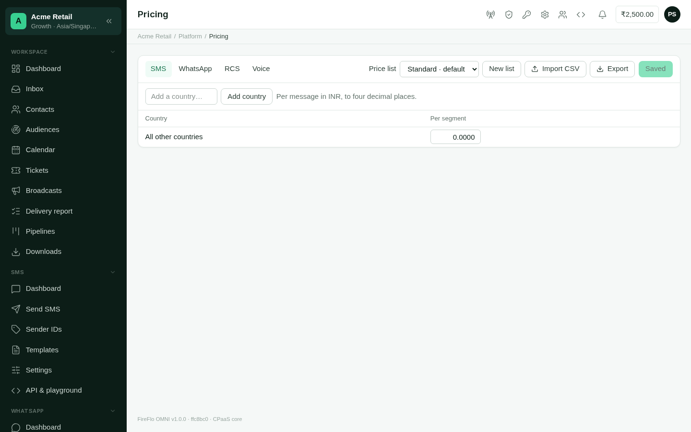

**Platform → Pricing** sets what your customers pay per message on each channel. Prices
are kept in **price lists**. Each list holds a grid for each channel: countries down the
side, product types across the top.

**Who can use it:** platform staff.

<Frame caption="Platform → Pricing: one channel's prices in one list, a country per row.">
  
</Frame>

Prices are saved **in OMNI only**. WhatsApp, RCS and Voice are charged by OMNI, so a saved
price applies to their next message. SMS is charged by the SMS gateway, so a saved SMS price
reaches it only when staff [review and apply](#apply-sms-prices-to-the-gateway) it.

## Which price a customer pays

Two questions decide the price of one message:

1. **Whose list?** The customer's own list if you've given them one. Otherwise, the list
   their product carries. Otherwise, the **default** list.
2. **Which row?** The row for the recipient's country, as the
   [country directory](/operators/countries) reads the number. If that country has no
   price of its own, the **All other countries** row applies. For SMS, a country with
   neither is charged the gateway's own price.

A reseller pays from its own list. Its customers have no prices at all: they send with
[units](/using/units), and each message is charged to the reseller at the reseller's price.

Your customers see their prices on their [Billing](/using/billing#prices) page. A price of
zero counts as "not priced yet", so it isn't listed there.

## What each channel charges for

| Channel | Product types |
| :--- | :--- |
| **SMS** | Per segment, and each message type your SMS gateways offer (such as Transactional or Promotional) |
| **WhatsApp** | Marketing, Utility, Authentication, Service reply |
| **RCS** | Basic, Rich card, Carousel or media |
| **Voice** | Per minute, Per AI agent minute |

Only channels this deployment carries appear as tabs.

## Set prices

<Steps>
  <Step title="Choose the channel and list">
    Pick the channel from the tabs, and the list from **Price list**. The default list is
    marked **· default**.
  </Step>
  <Step title="Find or add the countries you price">
    **Find a country or +code** narrows the grid by name, two-letter code or calling code.
    To price a new country, type its two-letter code in **Add a country…** and select
    **Add country**. The **All other countries** row is always last.
  </Step>
  <Step title="Enter prices">
    Type each price in the currency shown beside **Per message in**, to up to four decimal
    places. Changed rows are highlighted. Clearing a cell removes that price.
  </Step>
  <Step title="Save">
    Select **Save prices**. Only the rows you changed are sent, so two people pricing
    different countries at the same time don't overwrite each other.
  </Step>
</Steps>

A price can't be negative. **History** on each row opens that country's
[price history](/operators/price-history-and-import).

On SMS, **Compare with** shows a gateway's own default price under each of yours, to see
which of your prices differ from it.

## Apply SMS prices to the gateway

Saving an SMS price doesn't change what the gateway charges. Until staff apply it, the
gateway keeps charging its current prices, and screens that show the new price mark it
**Waiting to apply**.

**Waiting to apply on the gateway**, above the grid, lists every change the gateway hasn't
taken yet: what changed, who made it, how many accounts it reaches, which gateway, and
since when. These all wait there:

- a price saved in the grid or brought in by an [import](/operators/price-history-and-import#import);
- a customer moved to another price list, or given [allowed countries](/operators/customers#sending);
- a change to a country's number prefixes in the [country directory](/operators/countries);
- a new account's first prices.

When nothing waits, the panel says **Nothing waiting**.

<Steps>
  <Step title="Open the alert">
    Select **Review and apply**. OMNI reads each gateway's current prices. Nothing is sent
    to a gateway yet.
  </Step>
  <Step title="Check the gateways">
    Each gateway is listed with its currency. Only a gateway whose currency is the prices'
    currency can be applied; it reads **Currency matches**. A gateway in another currency
    is **Skipped**, and its accounts keep their current gateway prices. Untick a gateway
    to leave it out this time.
  </Step>
  <Step title="Check what will be replaced">
    For each gateway, the alert lists every country and product type that changes, with
    the price **On gateway now** beside the **New** one, and the accounts it reaches.
    **Warnings** names any account with a problem to look at first.
  </Step>
  <Step title="Confirm">
    Tick **I have checked the prices above** and select **Replace on N gateways**. Cancel
    changes nothing.
  </Step>
</Steps>

OMNI writes the prices and reads them back from the gateway. An account counts as applied
only when the read-back matches. One that fails stays waiting with the old prices and the
reason; one that was skipped says why. The panel then shows **Gateway last matched OMNI**
with the date.

New prices apply to messages sent after you confirm. Messages already sent keep the price
they were charged.

<Note>
  Every night OMNI compares each account's prices with what its gateway charges. A
  difference is listed under **Waiting to apply**. The nightly check never changes a
  gateway.
</Note>

### Where the gateway can't tell countries apart

The gateway prices by number prefix, from the [country directory](/operators/countries).
Countries that share a calling code can have prices of their own only when the directory
gives them prefixes of their own. When it can't tell two priced countries apart, the
apply stops and says so, rather than charge one country the other's price.

### Allowed countries and SMS sent straight to the gateway

A customer limited to some [allowed countries](/operators/customers#sending) has SMS
prices on the gateway for those countries only. OMNI refuses its sends to other countries
on every path through OMNI. SMS the customer sends straight to the gateway over its own
SMPP login is refused there only when the gateway is set to refuse messages no rate
prices, and has no default rate of its own covering those countries.

## Price lists

Select **New list** and name it to add a list. Use one for a product's prices, or for
one customer who negotiated their own.

To give a customer a list of their own, open their page and choose it under **Billing →
Prices**. See [Customers](/operators/customers#billing). Choose **Their product's list**
to put them back. For SMS, the change waits to apply like any other.

## What a change does to customers

A saved price applies to every customer whose price is decided by that list. For a
reseller, it changes what each later message of its customers costs the reseller. The
[units](/using/units) its customers hold never change with a price.

## Battery prices

Below the grid, **Battery prices** sets what each battery costs a customer a month, per
price list. The fee leaves the customer's wallet on the battery's renewal date; a
customer whose plan includes the battery pays nothing more. Zero means **not priced**,
and a battery that is not priced is free — so fill in every battery you mean to charge
for. A customer can be given a fee of their own on their page. See
[Customers → Billing](/operators/customers#billing).

## Related

- [Price history, export and import](/operators/price-history-and-import)
- [Countries](/operators/countries)
- [Resellers](/operators/resellers)
