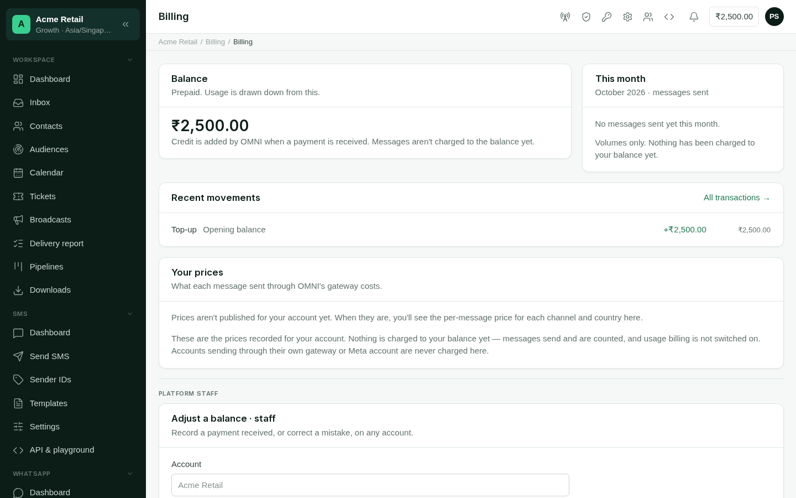
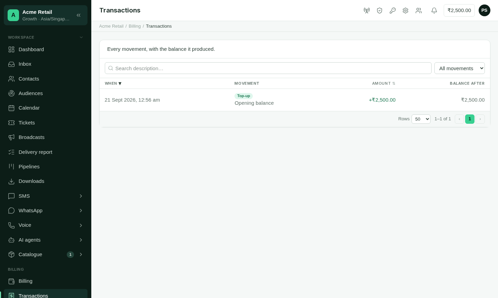

Billing answers **"how much do we have, and what does sending cost?"**

<Frame caption="Billing: the wallet on top, then Pockets, Plan & add-ons, Allocations and Prices.">
  
</Frame>

**Who can use it:** Owner, Admin, Billing and Reseller. **Transactions** needs permission
to see the ledger, which the same four roles have.

## The Billing screen

Billing shows only what your account has: the channels in your plan and connected, and
the batteries you have. A module your plan doesn't include, or one switched off, isn't
listed, unless money is still set aside for it (see [Pockets](#pockets)).

At the top, on every tab, is the **wallet**:

- **Wallet**: your prepaid balance, with **OK**, **Low** or **Empty**. It shows in red below
  zero, and it is also in the side menu of every screen. **Warn me** sets the amount below
  which you're told it's running low.
- **Charged in** this month: what messages and calls have cost so far this month, with the
  number of messages under it. A message can cost less than a paisa or a cent, so this
  figure shows up to four decimal places when it needs them.
- **In pockets**: the money set aside in pockets, and how many are open.
- **Add money**: credit is added by your provider when a payment is received; an account
  never tops itself up. For a reseller's customer, credit comes from the reseller. It also
  shows your plan's next renewal, and **How to pay** opens your [Plan](/using/plan-and-modules).

Below it are four tabs. An account below a reseller sees a different screen: see
[Accounts below a reseller](#accounts-below-a-reseller).

### Pockets

A pocket is money set aside for one module. While a channel has a pocket it spends **only**
from that pocket: when the pocket is empty, sends on that channel pause until you move more
money in, however much the wallet holds. A channel with no pocket spends from the wallet.

Each row shows what is in the pocket, what the module spent this month, and its state:
**OK**, **Low**, **Empty — sends paused**, or **Uses wallet** when it has no pocket
(for SMS on FireFlo's connection, see below).

- **Create pocket** opens a pocket with a first amount; **Move money** moves money either way
  between the wallet and the pocket.
- The **⋯** menu on each row holds **Warn me** (a low-balance warning for that pocket), its
  allocations, and **Remove pocket**, which closes an empty pocket so the module spends from
  the wallet again. A refund for a message charged to a removed pocket reopens it, so the
  money is where you can see it.
- A module that is no longer in your plan but still has money in its pocket stays listed
  as **Holds money**, with only **Move to wallet**: no new money goes in.
- Owners and the Billing role may move money, and may move it back to the wallet even
  while a payment is due.

#### SMS on FireFlo's connection

When SMS runs on FireFlo's connection it is paid for from its pocket **only**; it never
spends from the wallet.

- **No pocket — can't send**: create the SMS pocket and move money in. Until then nothing
  can be sent on SMS, however much the wallet holds.
- Money moved into it goes on to your SMS gateway and is spent on SMS.
- The pocket shows **what is left at your SMS gateway**, so it goes down as you send, with
  what was moved in beside it. The figure counts what the gateway has set aside for
  sending; the row says how much that is.
- **Move money → Pocket → wallet** brings money back. The gateway hands back what it set
  aside, then gives the money back; if it has less than you ask for, nothing moves. You can
  take back up to what was moved in. (With an older gateway the pocket works one way, and
  the row says so.)
- **Sync** reads the gateway again now and shows the time the figure was read. The page
  also reads it each time it loads; Sync is for when you have just sent, or money was just
  added at the gateway. It moves no money.
- Under the figure is how it came about: **Moved in** (what was put into the pocket),
  **Moved back** (what returned to the wallet), **At the gateway** (anything added or
  taken at the gateway itself), **Spent**, and **Left**. Spent is counted from the
  pocket's first reconcile on; before that it reads "known once reconciled". If the lines
  don't add up, the row says how much is not accounted for yet; your provider's staff can
  reconcile it, and the row says when that was last done.
- **about ₹…**: your SMS gateway is an older version that can't say the exact figure. It
  may read slightly high, by what the gateway has set aside for sending.
- The row says where top-ups of the wallet go: on to this pocket, or staying in the wallet
  until you move them. Change it under **SMS → Settings**.
- **At the gateway, not in a pocket**: before OMNI 1.5.10 your wallet was copied to the SMS
  gateway, so some of it is already there. **Create pocket** shows that amount and opens
  the pocket with it — it moves out of the wallet and nothing more is sent. Leave the
  amount empty to open with just that, or add an amount from what the wallet has left.

### Plan & add-ons

- **Your plan**: its monthly fee, its next renewal and its status, with **Change plan**.
- **Your batteries**: what each costs a month (or **Included**), when it next renews with
  **Auto-renew**, and whether it is **Included in plan**, renewing, or **Suspended** — then
  **Renew now** switches it back on. See [Batteries](#batteries).
- **Add-ons**: batteries your plan doesn't include that you can add, each with its monthly
  fee and **Subscribe**. Batteries your provider has switched off, or hasn't priced, aren't
  offered.

### Allocations

Every movement has a **Reference** of its own, with a copy button. For money moved to or
from your SMS gateway it is the same reference the gateway records, so the two can be
matched.

The latest changes to the wallet and pockets, each with when, what it was, the amount and
the wallet after it. **All transactions** opens the full ledger.

### Prices

**Your prices**: what each message costs you, per channel, country and product type, for
the channels your account has. Each price shows since when it applies, and your own
country is marked **your default**.

- **Find a country, IN or +91** finds a country by name, two-letter code or calling code.
- **All product types** narrows the list to one product type.
- **Export CSV** downloads the prices as a file.

An SMS price marked **Waiting to apply** is a new price FireFlo has saved that the SMS
gateway doesn't charge yet. Until it is applied, messages are charged the previous price.

Until prices are published for your account, this tab says so. Accounts sending through
their own gateway or Meta account are never charged here.

## Accounts below a reseller

When your account is a customer of a reseller, you send with **units** your reseller gives
you, not with money. See [Units](/using/units).

At the top, in place of the wallet summary:

- **Units left**: how many units you hold, across how many kinds, from your provider.
- **Plan** and **Add-ons**: what you are on, **Paid by** your reseller. You hold no money:
  there is no wallet, and nothing to top up.

The tabs are **Units**, **Plan & add-ons** and **Unit history**. There are no pockets, no
prices and no allocations.

- **Units** lists each channel and product type with the **Units left** and a status:
  **OK**, **Low**, or **None · sends paused** with **Ask your provider**. One unit is one
  message: an SMS part, a WhatsApp message, a call minute.
- **Unit history** lists units received from your provider, used by your messages, and
  given back when a message was refused.
- **Plan & add-ons** shows your plan and add-ons. Your reseller pays for them, so only
  your reseller can change your plan or add one; ask them. If a fee is unpaid, the page
  says so and your reseller has been told.

## How sends are charged

Each message and call that goes through **FireFlo's connections** is charged to the
balance as it goes, at your prices for the recipient's country. (Below a reseller, it
uses one of your [units](/using/units) instead, and is charged to your reseller.)

| Channel | Charged per | Priced as |
| :--- | :--- | :--- |
| SMS | part (a long SMS is several) | per part |
| WhatsApp | message | the template's kind — marketing, utility or authentication — or *service* for a message typed inside the 24-hour window. Reactions are free. |
| RCS | message | *basic* (text up to 160 characters), *single* (longer text) or *rich* (cards, carousels, pictures, PDFs) |
| Voice | started minute | per minute, charged when the call ends |

- **When.** A message is charged as it is handed to its channel. If the channel refuses
  it outright, the charge is refunded. A message the channel took but the phone never
  received stays charged, as the channel charges for it.
- **Your own connections aren't charged.** Messages through your own SMS gateway,
  WhatsApp account or RCS provider, and calls on your own Voice organisation, are billed
  to you by that provider directly.
- **When the money runs out.** A message its pocket (or, without a pocket, the wallet) can't
  cover isn't sent, and says which ran out. A broadcast pauses itself and carries on, by
  itself, as soon as money reaches the side it pays from: a channel with a pocket resumes
  when the pocket is filled, not when the wallet is. A call isn't placed on an empty pocket or
  wallet; one already under way finishes, and may take it a little below zero.
- **Not priced, not charged.** A channel or country with no price on your list costs
  nothing.
- **Only countries you can send to.** A message to a number outside your
  [allowed countries](#countries-you-can-send-to) is refused before it is sent, and isn't
  charged.

The wallet shows what has been charged this month, and the Pockets tab what each module spent.

## Countries you can send to

**Settings** shows **Countries you can send to**, on every channel: every country, or a
list. FireFlo sets it, or your reseller if you have one; you can read it but not change
it. Ask them to add a country.

A message to a number anywhere else is refused before it is sent, with the country the
number was read as, and isn't charged. A broadcast lists the rows it left out, by country.

## Batteries

Batteries are paid for month by month from the wallet. On each battery's renewal date
its monthly fee leaves the wallet and the battery is on for another month. Where your
plan includes a battery, it reads **Included in plan** and costs nothing more.

- **Subscribe** starts paying for a battery your plan does not include: the first month
  is charged now, and it renews on the same day each month.
- **Auto-renew** off stops the renewal; the battery stays on until the month already
  paid for ends, then reads **Not renewing**.
- When the wallet cannot pay a renewal the battery is **Suspended**: it is off, and
  Modules says why. Add money to the wallet and it comes back on by itself, or select
  **Renew now**. The owner is emailed once when this happens.

The plan itself renews the same way: its monthly price leaves the wallet on the renewal
date. See [Paying](#paying).

## Transactions

<Frame caption="Transactions: every movement, with the balance it produced.">
  
</Frame>

Every movement on the balance, newest first: when, what kind, the amount and the
balance after it. Search the descriptions, and filter by kind:

An amount is shown with two decimal places when it is a whole number of paise or cents, and
with up to four when it is not: a message priced at 0.0012 is charged 0.0012, and its line says
so. The balance beside it stays in two places, rounded down: what is left below a paisa or a
cent is kept and still pays for messages, but it isn't shown until it adds up.

| Kind | What it is |
| --- | --- |
| **Top-up** | Credit added when FireFlo recorded a payment |
| **Adjustment** | A correction made by FireFlo |
| **Credit received** | Credit a reseller moved to you |
| **Credit allocated** | Credit you, as a reseller, moved to a customer |
| **Usage** | What messages and calls cost — grouped, like "WhatsApp · 214 messages" or a broadcast's own line |
| **Refund** | What came back for messages a channel refused |
| **Moved to pocket** / **Moved from pocket** | Money moved between the wallet and a pocket: one line on each side |
| **Battery fee** | A battery's month, paid from the wallet |
| **Plan fee** | The plan's month, paid from the wallet |

The **Wallet and pockets** filter narrows the ledger to the wallet's own lines or to one pocket's. The
**After** column is the running figure of whichever side the line is on.

Usage is grouped so the ledger stays readable: a line grows while nothing else happens
on the account, for up to an hour, and the next movement starts a new one.

On a reseller's ledger, what its customers' WhatsApp, RCS and Voice messages cost shows as
**Usage** lines named after each customer. Their SMS is charged by the SMS gateway, from
the reseller's SMS balance there.

## Paying

Your plan is paid from your wallet: on the renewal date its monthly price leaves the
wallet and your paid time runs a month on. Money reaches the wallet by bank transfer or
cheque, recorded by FireFlo; the [Plan](/using/plan-and-modules) page says how. If the
wallet cannot pay the renewal, sending, campaigns and agents pause until money is added,
and the plan is paid as soon as it is.

Questions about a payment or your balance: write to
[support@fireflo.au](mailto:support@fireflo.au).
