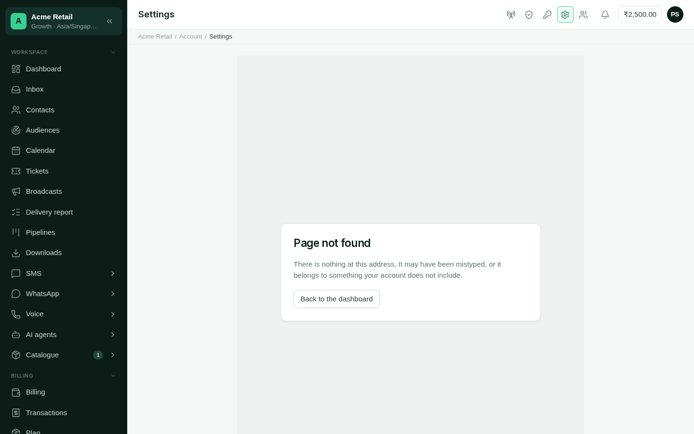

Branding answers **"what do my customers see?"** A reseller's customers use OMNI under
the reseller's brand: on the sign-in page, in the panel, and in the emails they get.

<Frame caption="Branding: your brand, and your own web address in three steps.">
  
</Frame>

**Who can use it:** the **Owner** or **Reseller** role, on a reseller account. Other
accounts don't have this screen: a customer's panel carries its provider's brand.

The page is four numbered sections, in the order you set them up. Sections 3 and 4 open
once your own address is live.

## 1 · Your brand

| Setting | What it does |
| --- | --- |
| **Brand name** | The name your customers see. Leave it empty to use your company name. |
| **Brand colour** | Buttons, links and highlights. |
| **Logo** | PNG, JPEG or WebP, up to 256 KB. |

Choose **Save brand**. **What your customers see**, at the foot of the page, previews
the result.

Emails to your customers carry your logo, your name and your colour, and their links go
to your address once it is live.

## 2 · Your own address

Give your customers a panel at an address of your own, such as
`panel.yourcompany.com`.

<Steps>
  <Step title="Save your panel's address">
    Enter the address and save it. Changing it later starts the setup again.
  </Step>
  <Step title="Add the records at your DNS provider">
    The screen shows a **CNAME** record and a **TXT** record. Copy each one to your DNS
    provider, then choose **Check DNS**. The status moves from *Waiting for your DNS* to
    *Waiting for your provider* once both are found.

    The CNAME points at your provider's panel: the address of the reseller above you
    when it has one of its own, otherwise the main panel. An **A record** to the same
    server passes the check too, for a domain that cannot hold a CNAME.
  </Step>
  <Step title="Your provider switches it on">
    Your provider adds your address to the panel's server with its certificate, usually
    within a working day of the records being found. The status then reads *Live*.
  </Step>
</Steps>

## 3 · Sign-in and sign-up pages

Once your address is live, **Open designer** takes you to the
[sign-in and sign-up pages](/using/sign-in-pages) designer. The section shows the
layout in use, whether a design is published, and whether a tracking code is running.

Before your address is live this section is locked, because the pages are shown on your
address and nowhere else.

## 4 · Sign-up on your address

New customers can create their own account on your address. Two switches have to be on:

1. **Your provider allows it** for your account. The badge reads *Allowed by your
   provider* once they have.
2. **You switch it on** with **Take sign-ups on your address**.

Sign-up must also be open on the platform as a whole. The line under the switch says
which of the three is missing.

When someone signs up on your address:

- their account is created under you, as your customer;
- their emails come in your brand, with links to your address;
- you get a notice and an email once they confirm their address, and nothing is sent
  for them until you approve the account.

Switch it off at any time. Your customers still sign in on your address.

See also [Resellers](/using/resellers).
