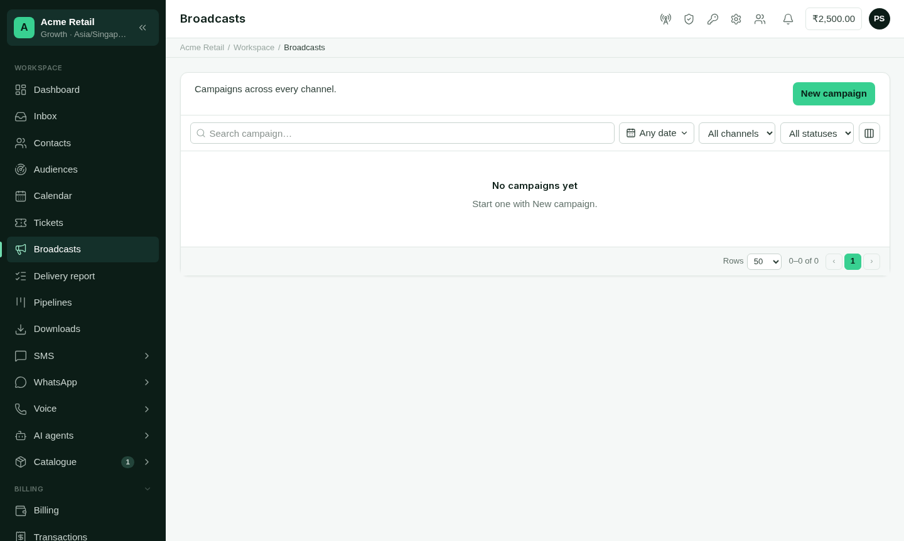
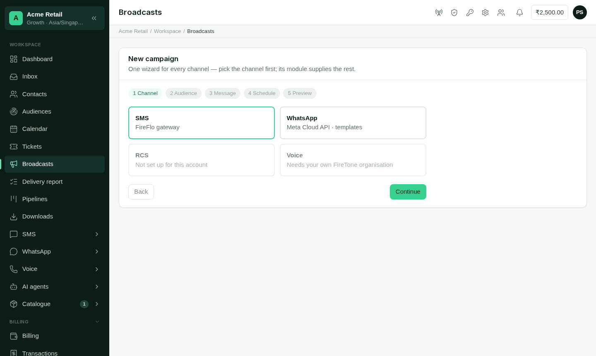

Broadcasts answers **"what have we sent to many people, and how did it go?"** A
broadcast (a *campaign* in the panel) sends one message to a list or to segments of
your contacts, on one channel.

<Frame caption="Broadcasts: every campaign across every channel, with its progress.">
  
</Frame>

**Who can use it:** anyone who may read messages sees the list and reports (Owner,
Admin, Support and Viewer). Starting, pausing, retrying and cancelling a campaign needs
permission to send (Owner, Admin and Support).

**Plan:** at least one channel that sends broadcasts must be switched on and connected.

## The list

Each campaign shows its channel, status, progress and when it was scheduled, started
and finished. Search by name, and filter by date, channel and status (*scheduled*,
*sending*, *sent*, *failed* or *cancelled*). The list refreshes itself while a campaign
is sending. Choose **Report** to open one.

<Tip>
Your own systems can start broadcasts too, through the OMNI API — see
[Broadcasts](/developers/broadcasts) for developers. They are listed here beside the
ones your team starts, and can be paused, resumed or canceled from either side.
</Tip>

## Starting a campaign

Choose **New campaign**. The **New broadcast** page has three steps, the same for every
channel; the channel you pick supplies the parts it needs.

<Frame caption="New broadcast: choose the channel, compose on one page, then review.">
  
</Frame>

<Steps>
  <Step title="Channel">
    Pick the channel to send on. Channels that aren't connected can't be picked.
  </Step>
  <Step title="Compose">
    One page, with a live preview beside it:

    - **Campaign name.**
    - **To**: **upload a file** (CSV or Excel, up to ten lakh rows) or choose **contact
      segments**. For a file, check the column that holds the numbers. You can also save
      the file's other columns to contact profiles. Batteries can add audiences of their
      own, such as saved audiences from [Customer data](/batteries/customer-data).
    - **From** and, on SMS, the **message type**. Say whether it is **marketing** (skips
      people who stopped offers) or **an update they expect** (skips only people who
      stopped everything).
    - **Message**, in the form the channel needs: an approved template on WhatsApp or
      RCS, a sender ID and (in India) a registered template on SMS. Each blank can be
      typed, or filled from a column or contact field so each person gets their own
      value. The preview steps through the rows. See [Channels](/channels/overview).
    - **When should it go?**

    | Choice | When it sends |
    | --- | --- |
    | **Now** | As soon as you confirm. |
    | **Later** | One date and time for everyone, from a few minutes to 30 days ahead. |
    | **Each row on its own date** | From a date column in an uploaded sheet, at the time you choose. |

    Times use your account's timezone (Settings). Rows whose date is blank, unreadable,
    past, or more than 30 days away are skipped.
  </Step>
  <Step title="Review">
    See how many messages **will be sent**, how many are **skipped** and why, and, for
    SMS, about how many parts. Download the skipped rows, or go back to compose. Nothing
    is sent or scheduled until you confirm here.
  </Step>
</Steps>

The channel's own send page ([Send SMS](/channels/sms), Send WhatsApp, Send RCS) does
the same for a file, a segment or an audience, without the campaign name and the
per-row dates.

### Why rows are skipped

The preview gives a reason for every skipped row, such as:

- not a valid phone number, or a number Excel shortened;
- the same number as an earlier row;
- the person stopped these messages, or has no opt-in for marketing;
- **Do not contact**, or inside the person's quiet hours;
- a date that is missing, unreadable, past or too far away;
- the message can't be written for that row, or the channel can't reach that country.

## A campaign's report

Open a campaign to see how it is going.

- **Figures**: recipients, delivered, failed, awaiting a report, and replied.
- **Details**: the message or template, sender, audience, who was left out, and whether
  it was marketing or an update.
- **Delivery**: what carriers reported, why messages failed, and deliveries per hour. The
  analysis runs by itself when the campaign finishes, and you can refresh it.
- **Recipients**: every number, its message, status and the carrier's answer or error.
- **Reports**: choose **Prepare** to write the full report as files you can download.
  They are kept in [Downloads](/using/downloads).

While a campaign runs, you can **Pause** and **Resume** it, or **Cancel** it (what was
already sent stays sent). When some messages failed and the channel can send again,
**Retry** queues the failed ones.

With [AI Agents](/batteries/ai-agents), you can also **ask about the campaign** in
plain words. Answers come from the campaign's analysis, never its raw rows, and count
towards your AI usage.
